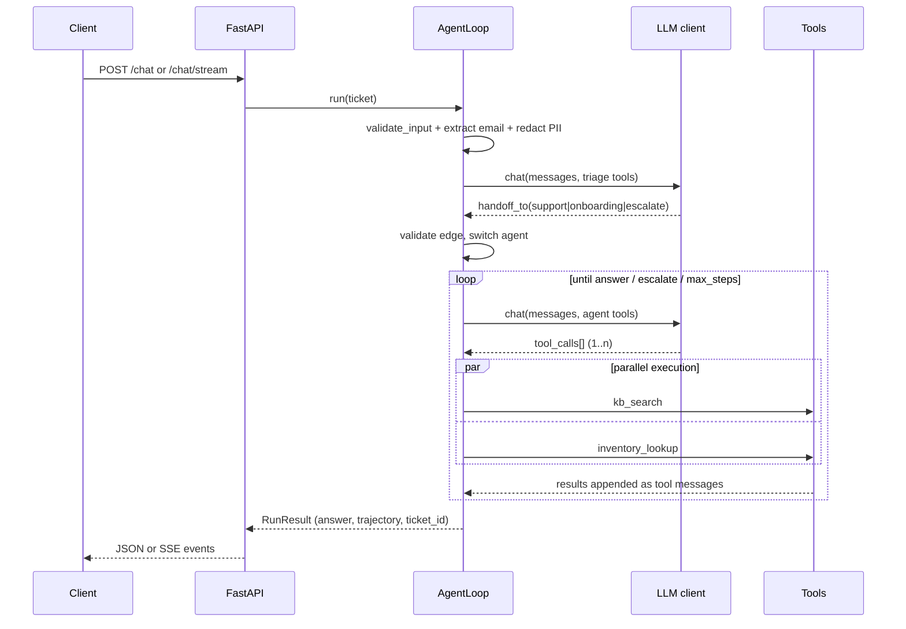

# ARCHITECTURE.md — Support Agent Tools

## 1. Goals & non-goals

**Goals:** demonstrate, in one runnable MVP, the core patterns of a production LLM agent
system: an explicit tool-use loop, parallel tool execution, specialist agents with
handoffs, input/output guardrails, structured outputs, and offline trajectory evals.

**Non-goals:** semantic retrieval (keyword search is enough to show the loop), a real
model dependency in tests, durable infra (SQLite + in-memory outbox are intentional
mocks behind swappable interfaces).

## 2. Design decisions

### 2.1 Explicit loop instead of an SDK dependency

The OpenAI Agents SDK pattern (agent → model → tools → handoff) is followed, but the
loop is handwritten (`src/loop.py::AgentLoop`, ~200 lines) rather than imported:

- **Offline-first:** tests and evals run with zero network and no API key.
- **Observable:** every turn emits typed events (`agent_start`, `tool_call`,
  `tool_result`, `handoff`, `final`) consumed both by `run()` and the SSE endpoint —
  one code path, no drift between batch and streaming.
- **Controllable:** max-step budget, handoff interception and guardrail hooks are
  first-class, not framework callbacks.

### 2.2 Three LLM clients behind one protocol

```python
class LLMClient(Protocol):
    async def chat(self, messages, tools) -> LLMResponse: ...
```

| Client | Used by | Purpose |
|---|---|---|
| `OpenAILLMClient` | prod (`MOCK_MODE=false` + key) | Real Chat Completions + function calling over httpx (no `openai` package needed) |
| `RuleBasedLLMClient` | demos, evals, default API mode | Deterministic policy mirroring the agent instructions; makes golden trajectories reproducible |
| `MockLLMClient` | unit tests | Scripted response queue (repeats last) for loop mechanics: multi-step, parallel, caps, invalid handoffs |

Messages use the OpenAI shape (`system/user/assistant/tool` + `tool_calls`), so swapping
clients never changes the loop.

### 2.3 Handoff as an intercepted tool

`handoff_to(target_agent, reason)` is declared like any other function tool (so models
and the rule-based client emit it naturally), but the loop intercepts it *before*
execution: it validates the edge against `HANDOFF_GRAPH`, switches the active agent
(appending a fresh system prompt), and records the transition in the trajectory.
`escalate` is a terminal pseudo-target, not an agent. Invalid edges are blocked and
escalated — tested in `test_invalid_handoff_is_blocked_and_escalated`.

### 2.4 Least-privilege tool allowlists

`AGENT_TOOLS` maps each agent to the tools it may see: triage only routes, support
cannot touch customer/onboarding tables, onboarding cannot touch inventory. Schemas
sent to the model are filtered per active agent.

### 2.5 PII strategy: redact the transcript, verify the contact

Free-text PII (email/phone/SSN/Luhn-checked cards) is redacted before the ticket reaches
the model, the logs, or the final answer. But agents legitimately need *a* contact
address to create records and send confirmations — so the loop extracts the first email
pre-redaction and injects it as a labeled, system-provided `verified contact` field.
This separates *untrusted transcript text* from *verified structured context*, the same
distinction production systems make with CRM lookups.

### 2.6 Tools return envelopes, never raise into the loop

`execute_tool` wraps every call in `{"ok": True, "data": …}` /
`{"ok": False, "error": …}` and runs sync tools via `asyncio.to_thread`, so same-turn
calls execute concurrently and one failing tool degrades the turn instead of crashing
the run.

## 3. Runtime flow



## 4. Data & persistence

- **SQLite** (`data/support.db`, stdlib `sqlite3`, one connection per call):
  `tickets`, `customers`, `onboarding` tables. Path overridable via settings /
  `set_db_path()` — tests and evals use temp dirs.
- **KB** (`data/kb.json`): 10 curated articles with tags; `search_kb` scores
  title×3 + tags×2 + body×1 token overlap after stopword removal.
- **Outbox**: in-memory list; assertions in tests read it directly.

## 5. Evaluation strategy

Two layers, both offline:

1. **Unit tests (35)** — tools, guardrails, loop mechanics with scripted mocks,
   routing + full cross-agent paths with the rule-based client.
2. **Golden trajectory evals (17 tasks)** — each task pins `expected_agents`,
   `expected_tools` and `expected_outcome`. Scoring: LCS-based F1 on the tool
   sequence (order-sensitive but tolerant), exact agent-path match, exact outcome
   match. Pass bar: F1 ≥ 0.8 + both matches. `eval/run_evals.py` prints a table and
   exits non-zero below `--threshold` (default 0.8) — CI-ready.

Deliberately not included (yet): LLM-as-judge answer quality, adversarial/red-team
prompts, latency budgets. Those are the natural next eval layers.

## 6. Failure modes & mitigations

| Failure | Mitigation |
|---|---|
| Model emits unknown tool / bad args | `execute_tool` envelope error; loop continues |
| Model loops forever | `max_steps` budget → auto-escalation |
| Invalid handoff target | Graph check → blocked + escalated |
| PII in ticket | Redaction pre-model; sanitized final answer |
| Empty/oversized input | `validate_input` → HTTP 422 |
| Tool crash (DB locked, …) | try/except envelope; turn degrades, run continues |
| Key missing in prod mode | Falls back to rule-based client unless explicitly configured |

## 7. Extending the system

- **New tool:** add `TOOL_SCHEMAS` + `FUNCTIONS` entries in a `src/tools/*_tool.py`
  module (auto-registered), then add the name to the relevant `AGENT_TOOLS` allowlist.
- **New agent:** add to `AgentName` + `AGENTS` + `HANDOFF_GRAPH`, extend
  `RuleBasedLLMClient` with its policy turn, pin golden tasks.
- **Real model:** set `MOCK_MODE=false` + `OPENAI_API_KEY`; any OpenAI-compatible
  endpoint works by changing the base URL in `OpenAILLMClient`.
- **Real infra:** replace `db_tool` internals with Postgres, `email_tool` with
  SendGrid/SES, `inventory_tool` with the OMS client — the registry interface
  (`FUNCTIONS: dict[str, Callable]`) stays identical.
