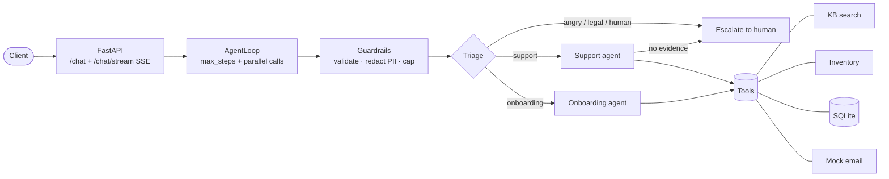
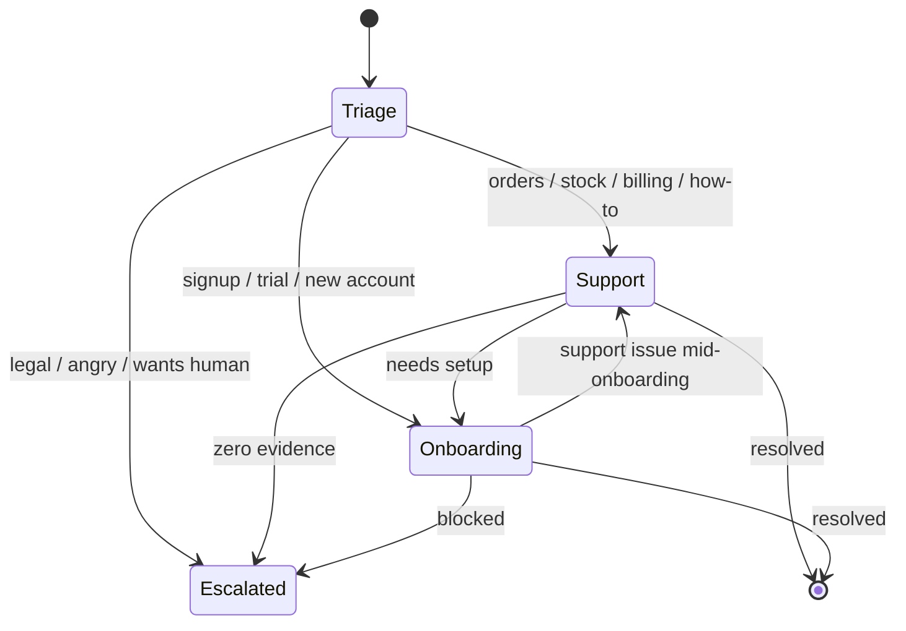

# Support Agent Tools

A production-grade **multi-agent LLM system** (MVP) for client onboarding + customer support,
built with an explicit **tool-use loop**, **parallel tool calls**, **agent handoffs** and
**guardrails** — following the OpenAI Agents SDK pattern, with zero hard dependency on any
model provider at test time.

> Built with agentic coding assistants (**Claude Code / Cursor** style workflow): spec-first,
> test-driven, docs-as-code. See `ARCHITECTURE.md` for the full design rationale.
>
> ✅ **Live-verified** against a real LLM API: real function-calling confirmed (opencode Zen, free `beam-free` model, 2026-11-05) — see `docs/LIVE_VERIFIED.md`.

## Problem

Support teams drown in repetitive tickets: password resets, order status, stock questions,
new-customer setup. A single-prompt chatbot hallucinates answers and can't *act*.
This project shows the next step: **agents that read a ticket, consult tools (KB, inventory,
database), take action (create records, send email), escalate when unsure — and prove it
with trajectory evals.**

## Architecture



## Handoffs



## Stack

| Layer | Choice |
|---|---|
| Language | Python 3.11+ (type hints, `from __future__ import annotations`) |
| API | FastAPI + SSE streaming (`StreamingResponse`, `text/event-stream`) |
| Agent pattern | OpenAI Agents SDK style (agents + tools + handoffs), explicit async loop |
| LLM | `OpenAILLMClient` (httpx, Chat Completions + function calling) in prod; `RuleBasedLLMClient` offline; `MockLLMClient` in tests |
| Structured outputs | Pydantic v2 models (`RouteDecision`, `RunResult`, `FinalAnswer`, …) |
| Tools | Mock inventory API, JSON knowledge base, SQLite records, mock email outbox |
| Guardrails | Input validation, PII redaction (email/phone/SSN/card), max-iteration cap, output sanitizing |
| Tests / evals | pytest + pytest-asyncio, golden-trajectory evals (LCS F1 + agent-path + outcome) |

## Quickstart

```bash
cd support-agent-tools
python3.11 -m venv .venv && source .venv/bin/activate
pip install -r requirements.txt
cp .env.example .env   # optional; tests + evals run offline with MOCK_MODE=true

# Run tests (offline, mocked LLM — no API key needed)
pytest -q

# Run the golden trajectory evals (17 tasks, offline)
python eval/run_evals.py

# Serve the API
uvicorn src.api:app --reload --port 8000
```

Try it:

```bash
curl -s localhost:8000/health
curl -s localhost:8000/chat -H 'Content-Type: application/json' \
  -d '{"message":"Do you have ACME-1001 in stock? bob@example.com"}'
# SSE stream:
curl -N localhost:8000/chat/stream -H 'Content-Type: application/json' \
  -d '{"message":"We just signed up, help us get started! dave@newco.com"}'
```

To use a real model, set in `.env`:

```env
MOCK_MODE=false
OPENAI_API_KEY=sk-...
MODEL=gpt-4o-mini
```

## Tools

| Tool | Agent(s) | What it does |
|---|---|---|
| `handoff_to` | all | Hand the ticket to `support`, `onboarding` or `escalate` (loop-intercepted) |
| `kb_search` / `kb_get_article` | support, onboarding | Keyword search over `data/kb.json` (10 articles) |
| `inventory_lookup` / `inventory_list_products` / `inventory_reserve` | support | Mock catalog: 8 SKUs, stock levels, reservations |
| `db_create_ticket` / `db_get_ticket` / `db_update_ticket_status` | support | SQLite ticket records |
| `db_create_customer` / `db_get_customer` | onboarding | SQLite customer records |
| `db_create_onboarding` / `db_complete_onboarding_step` | onboarding | 5-step onboarding checklists |
| `email_send` | support, onboarding | Mock email → in-memory outbox (validated, no network) |

Same-turn tool calls execute concurrently via `asyncio.gather` + `asyncio.to_thread`
(see the `kb_search` + `inventory_lookup` parallel turn in task `t02`).

## Guardrails

- **Input**: rejects empty / oversized (>4000 chars) / null-byte messages.
- **PII redaction**: emails, phones, SSNs and (Luhn-validated) card numbers are redacted
  before the transcript reaches the model or logs; the customer email needed for actions is
  extracted pre-redaction and passed as a system-provided `verified contact` field.
- **Iteration cap**: `max_steps` (default 12); exhaustion → automatic escalation, never a hang.
- **Handoff validation**: every `handoff_to` is checked against the handoff graph; invalid
  edges are blocked and escalated.
- **Output**: final answers are re-sanitized for leaked PII.

## Evals

`eval/golden_tasks.json` holds **17 golden tasks** (KB resolution, stock checks, onboarding
with/without email, anger/legal escalation, gibberish escalation, reservations, plan
detection…). `eval/run_evals.py` replays them offline through the rule-based client and
scores each run on:

- **Trajectory F1** (LCS over the tool-call sequence vs expected, ≥ 0.8 to pass),
- **Agent-path match** (e.g. `triage → support`),
- **Outcome match** (`resolved` vs `escalated`).

Current status: **17/17 passing (1.0)**. CI gate suggestion: fail below `--threshold 0.8`.

## Project layout

```text
support-agent-tools/
├── README.md  ARCHITECTURE.md  requirements.txt  .env.example  pyproject.toml
├── src/
│   ├── config.py        # pydantic-settings
│   ├── agents.py        # Triage/Support/Onboarding + handoff graph + router
│   ├── loop.py          # explicit agent loop (stream + run), 3 LLM clients
│   ├── guardrails.py    # validation, PII redaction, iteration caps
│   ├── evals.py         # trajectory scoring (LCS F1, agent path, outcome)
│   ├── api.py           # FastAPI: /health /tools /chat /chat/stream (SSE)
│   └── tools/           # inventory_tool, kb_tool, db_tool (SQLite), email_tool (mock)
├── data/kb.json         # 10-article knowledge base
├── eval/golden_tasks.json  eval/run_evals.py
└── tests/               # 35 tests: tools, loop, guardrails, handoffs (mocked LLM)
```

## Limitations & next steps

- Retrieval is keyword-based; swap `kb_tool` for embeddings + pgvector for semantic search.
- `RuleBasedLLMClient` is a deterministic stand-in; point `MOCK_MODE=false` at OpenAI
  (or any OpenAI-compatible endpoint) for real function calling.
- Outbox/email and inventory are mocks — replace with SendGrid/OMS adapters behind the
  same `FUNCTIONS` interface (the registry makes this a drop-in swap).
- Add an LLM-as-judge answer-quality eval alongside trajectory scoring.
